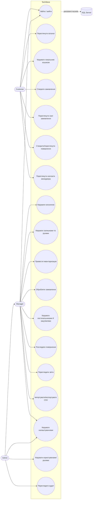
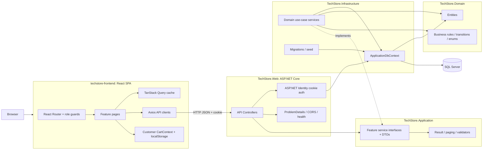
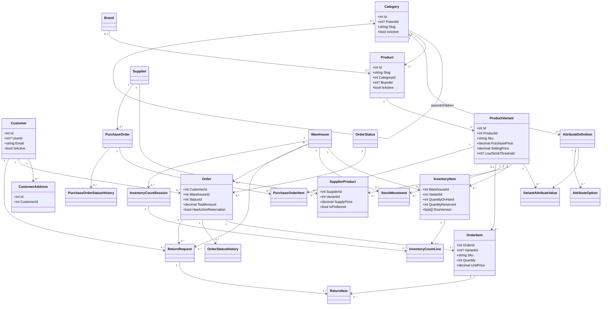
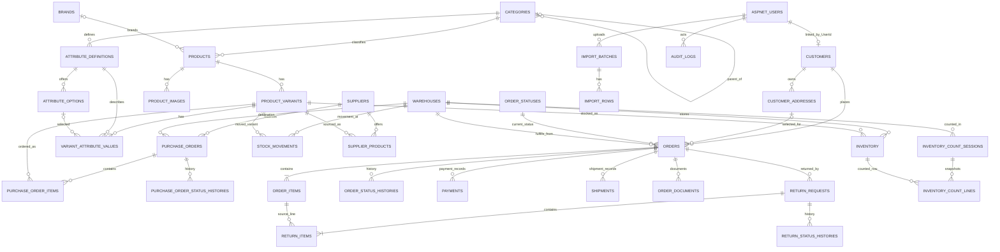
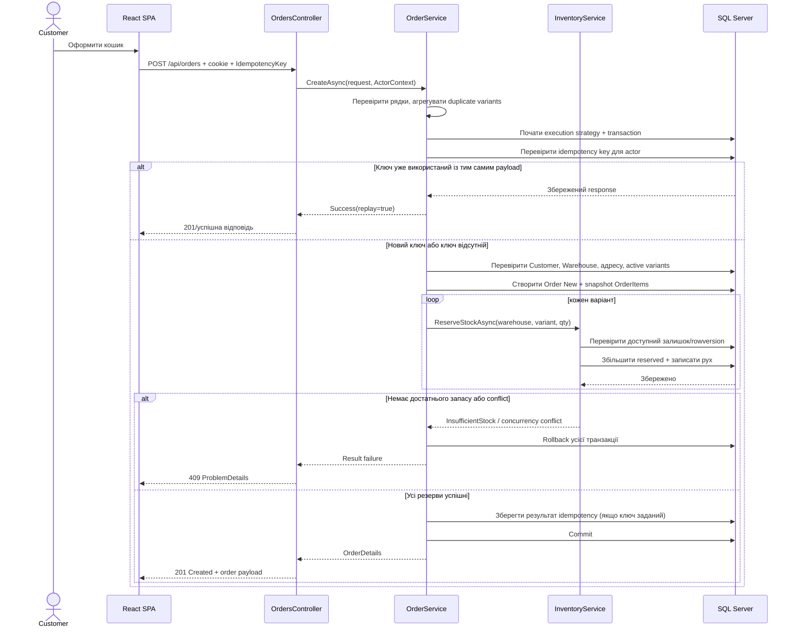
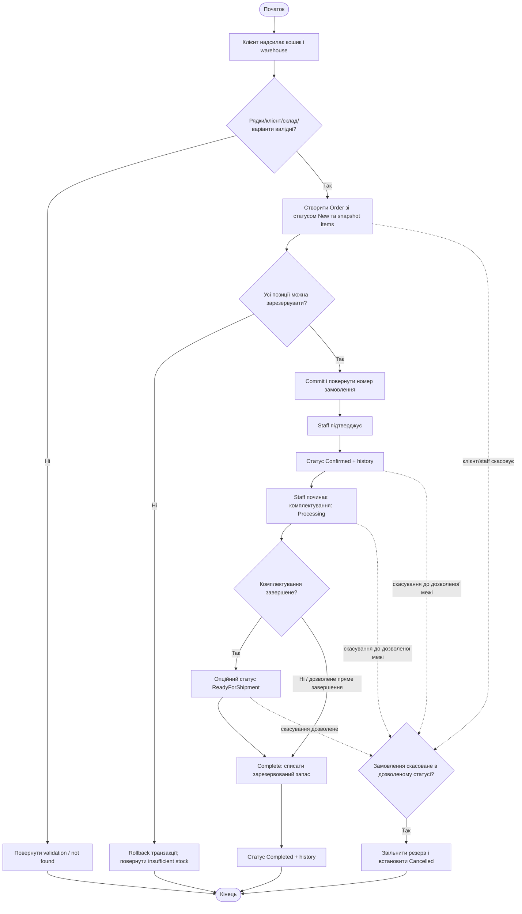
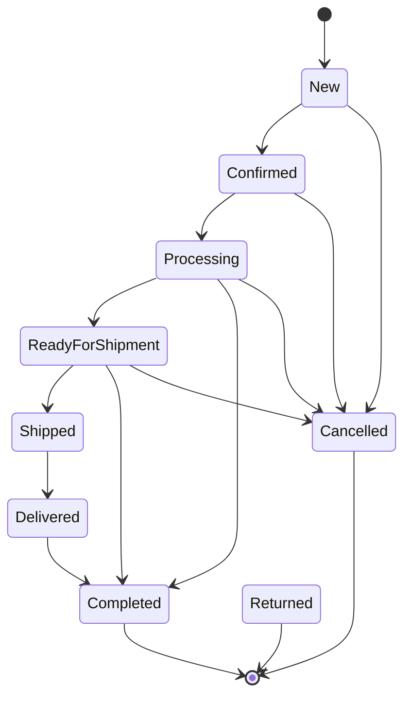
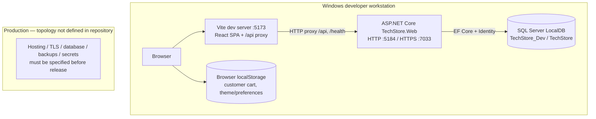

# TechStore — повний технічний та бізнес-опис проєкту

> **Призначення документа.** Єдиний докладний опис поточної реалізації TechStore: бекенд у `D:\project\techstore-backend`, пов'язаний frontend у `D:\project\techstore-frontend`, доменна/бізнес-логіка, дані, API, запуск, обмеження та готові специфікації для восьми архітектурних діаграм.
>
> **Точність.** Опис сформовано за кодом двох репозиторіїв, конфігурацією, EF Core-моделлю, контролерами, сервісами, міграціями й тестами. Там, де код моделює поняття, але готового зовнішнього інтеграційного процесу не видно, це прямо позначено як «модель/заготовка», а не як чинна інтеграція. Продакшн-хостинг, SLA, користувацькі сценарії поза кодом та зовнішні контракти невідомі й не домислюються.

---

## 1. Короткий опис і призначення

TechStore — вебзастосунок для обліку та операційної роботи магазину техніки. Він містить:

- **адміністративний інтерфейс** для персоналу: каталог, залишки, складські рухи, замовлення, клієнти, постачальники, закупівлі, повернення, інвентаризації, звіти, CSV-імпорт/експорт, налаштування й адміністрування;
- **клієнтську зону** в тому самому SPA: каталог, локальний кошик, оформлення/перегляд замовлень, звернення щодо повернення та контакт менеджера;
- **ASP.NET Core Web API** з cookie-автентифікацією та ролями;
- **реляційну базу SQL Server**, налаштовану через EF Core і міграції;
- бізнес-сутності для каталогу, складу, замовлень, закупівель, повернень, інвентаризацій, аудит-журналу й імпортів.

Це один монолітний бекенд і один frontend-застосунок, а не набір мікросервісів. Компоненти frontend/backend є окремими репозиторіями та запускаються окремо в локальному режимі розробки.

### Межі, які важливо врахувати

1. **Оплата та доставка.** У моделі існують `Payment`, `Shipment`, їхні статуси та спосіб доставки. У переглянутій Web/API-реалізації немає платіжного шлюзу, webhook-обробника чи інтеграції з перевізником. Замовлення й складські операції — реальні функціональні модулі; зовнішня оплата/логістика не підтверджені.
2. **Етапи доставки замовлення.** Доменна машина статусів включає `Shipped` і `Delivered`, однак чинний `OrdersController` відкриває лише `confirm`, `start-processing`, `complete` і `cancel`. Окремих API-операцій для відправлення/доставки в контролері не виявлено.
3. **Application layer.** Проєкт поділений на Domain/Application/Infrastructure/Web і має інтерфейси use case-сервісів у `TechStore.Application`, але `Application.DependencyInjection` наразі порожній (коментар про реєстрацію сервісів у майбутньому). Реальні реалізації use case-сервісів зареєстровано в Infrastructure.
4. **Немає ознак production deployment у репозиторії.** Є локальні launch profiles, LocalDB та dev seed. Не знайдено задокументованої production-топології, CI/CD, домену, хмарної БД чи зовнішнього платіжного/поштового сервісу.

---

## 2. Склад репозиторіїв і шари архітектури

### Backend: `techstore-backend`

Solution: `TechStore.sln`. Основні проєкти:

| Проєкт | Відповідальність | Основні області |
|---|---|---|
| `TechStore.Domain` | Сутності, enum-и, спільні правила, ролі та переходи станів | `Entities/`, `Enums/`, `Common/`, `Exceptions/` |
| `TechStore.Application` | DTO, запити, контракти сервісів, `Result`, пагінація, спільні валідатори | `Features/*`, `Common/` |
| `TechStore.Infrastructure` | EF Core, SQL Server, Identity storage, seed, репозиторна/сервісна реалізація бізнес-сценаріїв | `Persistence/`, `Services/`, `Identity/`, `Seed/` |
| `TechStore.Web` | HTTP API, автентифікація/авторизація, middleware, health checks, запуск | `Controllers/`, `Program.cs`, `Extensions/` |
| `TechStore.UnitTests` | Юніт-тести доменних правил і простих application helpers | `tests/TechStore.UnitTests` |
| `TechStore.IntegrationTests` | Тести API/сервісів/контексту та авторизації | `tests/TechStore.IntegrationTests` |

Залежності в основному спрямовані всередину: Web звертається до Application-контрактів і Infrastructure-композиції; Infrastructure використовує Application і Domain; Application використовує Domain. Під час аналізу важливо розрізняти **логічну архітектуру** й **фактичне місце виконання**: сервіси з EF-запитами та бізнес-оркестрацією розміщені в `TechStore.Infrastructure/Services`.

### Frontend: `techstore-frontend`

Структурні області `src/`:

| Шлях | Призначення |
|---|---|
| `src/app/` | Router, providers, ролева охорона маршрутів, layout-и й тема |
| `src/api/` | Axios-клієнт та клієнти API, згруповані за доменами |
| `src/features/` | Сторінки та доменні UI-модулі |
| `src/components/` | Спільні таблиці, діалоги, статуси та зворотний зв'язок |
| `src/hooks/` | Хуки URL-стану/параметрів таблиць |
| `src/types/` | Контрактні типи frontend |

Є два layout-и: `AdminLayout` для персоналу та `CustomerLayout` для клієнта. Обидві зони — в одному React SPA, з окремими route guards.

---

## 3. Технології

### Backend

- .NET SDK, цільова платформа **.NET 8** (`net8.0`); `global.json` фіксує SDK `8.0.300` з `rollForward: latestFeature`.
- **ASP.NET Core Web API / MVC controllers**, `[ApiController]`, `ProblemDetails`.
- **ASP.NET Core Identity** з `ApplicationUser`, `ApplicationRole` і збереженням через EF Core.
- **EF Core 8.0.11**: `Microsoft.EntityFrameworkCore.SqlServer`, Identity EF, migrations, retry-on-failure (`maxRetryCount: 5`).
- **SQL Server**. Локальні connection strings у конфігурації використовують SQL Server LocalDB: `TechStore` для базових налаштувань і `TechStore_Dev` для Development.
- `Microsoft.Extensions.Diagnostics.HealthChecks.EntityFrameworkCore` — readiness перевіряє підключення до DbContext.
- Unit/integration tests: **xUnit 2.5.3**, `Microsoft.NET.Test.Sdk 17.8.0`; integration tests мають `Microsoft.AspNetCore.Mvc.Testing` та EF InMemory.
- nullable reference types увімкнено; implicit usings увімкнено; спільний target framework задається в `Directory.Build.props`.

### Frontend

- **React 19**, **TypeScript 6**, **Vite 8**, ESM.
- **React Router 7** для SPA-навігації.
- **MUI 9**, Emotion, MUI X Date Pickers, **Day.js** для UI/локалізації дат.
- **TanStack Query 5**: кеш серверних запитів; retry 1 раз, stale time 30 с, без refetch on window focus.
- **Axios**: HTTP, cookie credentials, interceptor на 401.
- **React Hook Form + Zod**: форми/валідація.
- **Recharts**, Lucide, notistack.
- `oxlint`; команди `npm run build`, `npm run lint`, `npm run dev`, `npm run preview`.
- Залежності проєкту встановлювались із `npm install --legacy-peer-deps` згідно з README (peer dependency compatibility).

---

## 4. Як запускається система

### Локальний frontend/backend

1. Потрібні .NET 8 SDK, Node.js/npm та SQL Server LocalDB (або сумісний SQL Server із відповідним connection string).
2. Backend запускається з `D:\project\techstore-backend`:

   ```powershell
   dotnet restore TechStore.sln
   dotnet run --project src/TechStore.Web
   ```

   HTTP launch profile — `http://localhost:5184`; HTTPS профіль — `https://localhost:7033` і HTTP `5184`.
3. Frontend запускається з `D:\project\techstore-frontend`:

   ```powershell
   npm install --legacy-peer-deps
   npm run dev
   ```

   Vite працює на `http://localhost:5173`. Proxy передає `/api` і `/health` на `http://127.0.0.1:5184`; перевизначення — `VITE_API_PROXY`.
4. Vite налаштований на proxy, а API Axios використовує `baseURL: '/'` і `withCredentials: true`. У типовому dev-сценарії браузер звертається до того самого origin Vite, який проксить API. Сервер також задає CORS policy для `localhost:5173` та `127.0.0.1:5173` з credentials.
5. Backend під час старту за замовчуванням викликає `Database.MigrateAsync`, додає відсутні ролі/статуси й створює admin-користувача за конфігурацією, якщо seed-параметри задані. `Database:SeedDemoData` за замовчуванням вимкнений.
6. Для демонстраційних записів є команда/скрипт `scripts/Seed-DemoData.ps1`, який запускає Web із `--seed-demo`; це Development-only сценарій для LocalDB `TechStore_Dev`. Скрипт позначає демо-пароль виводом у консоль, тому не запускайте його в середовищі з реальними користувачами.

### Змінні й конфігурація

| Налаштування | Де використовується | Значення/поведінка за кодом |
|---|---|---|
| `ConnectionStrings:DefaultConnection` | Infrastructure | Обов'язковий; відсутність завершується `InvalidOperationException`. Поза репозиторієм задавати secret/configuration provider. |
| `Database:SeedOnStartup` | Web startup | За замовчуванням `true`; вимкнути можна через конфігурацію. У Development помилка seed/migrate логується, застосунок може продовжити старт; в інших середовищах помилка повторно кидається. |
| `Database:SeedDemoData` | `DbSeeder` | Типово `false`; вмикається CLI-прапорцем `--seed-demo`. |
| `Seed:AdminUser:*` | Identity bootstrap | Email/пароль/ім'я створення початкового Admin. Значення у файлах конфігурації — лише локальний приклад, не production secret. |
| `VITE_API_PROXY` | Vite | Proxy target API; типовий `http://127.0.0.1:5184`. |
| `VITE_MANAGER_NAME`, `VITE_MANAGER_PHONE`, `VITE_MANAGER_EMAIL` | Frontend | Публічні контактні дані менеджера для login/customer UI; не є секретами. |
| `ASPNETCORE_ENVIRONMENT` | ASP.NET Core | `Development` заданий у launch profile; впливає на exception handling і конфігурацію. |

### Health endpoints

- `GET /health/live` — liveness, повертає `{ status: "Healthy" }`.
- `GET /health/ready` — readiness через ASP.NET Core health checks, включно з доступністю `ApplicationDbContext`.

---

## 5. Автентифікація, ролі та доступ

### Механізм входу

- ASP.NET Core Identity, логін через email/пароль, cookie-сесія; налаштування Bearer authentication у переглянутому коді не виявлено.
- `POST /api/account/login` — анонімний endpoint. Для неактивного/невідомого користувача й невірного пароля відповідь — 401 без уточнення причини. Увімкнено `lockoutOnFailure: true`.
- `POST /api/account/logout`, `GET /api/account/me` — тільки для автентифікованих користувачів.
- Cookie: `HttpOnly`, `SameSite=Lax`, `SecurePolicy=SameAsRequest`, `SlidingExpiration=true`. Cookie redirects для API змінені на HTTP 401/403, а не HTML redirect.
- Парольні вимоги Identity: довжина від 8, потрібні цифра, lowercase та uppercase; special character не є обов'язковим; email унікальний; підтвердження email не вимагається.
- При 401 frontend видаляє локального користувача й переводить на `/login` (крім самого login-запиту). При старті `AuthProvider` викликає `/me`.

### Ролі

| Роль | UI-доступ | Типові API-повноваження |
|---|---|---|
| `Admin` | Усі staff-маршрути; окремо користувачі й audit logs | Повний staff-доступ, керування користувачами та аудитом, змінювання settings |
| `Manager` | Адміністративна панель, без admin-only сторінок | Операції каталогу, замовлень, запасів, закупівель, повернень, звітів, імпорту/експорту, читання settings |
| `Customer` | `/app/*` | Самостійне створення/читання доступних йому замовлень/повернень; обмеження власності реалізує сервіс |

Перевірка маршруту в SPA **не замінює** серверну авторизацію. Backend застосовує `[Authorize]` на контролерах/операціях і додаткову перевірку `ActorContext` для власності клієнта.

### Основні правила доступу в API

- Admin-only: `/api/users`, `/api/audit-logs`; зміна settings — Admin.
- Admin/Manager: більшість операцій постачальників, закупівель, звітів, імпортів/експортів, атрибутів/брендів/клієнтів та складських рухів.
- Authenticated user: контролери Products, Categories, Inventory та Warehouses позначені `[Authorize]` без переліку ролей на рівні контролера; точний доступ до кожної операції слід звіряти з action attributes і сервісними перевірками.
- Orders/Returns: контролер допускає Admin/Manager/Customer; сервіс фільтрує записи/перевіряє доступ до замовлення чи повернення за роллю та customer-user link.
- Settings: читання Admin/Manager, upsert — Admin.

---

## 6. API — карта модулів

API має префікс `/api`. Контракт — JSON, а paged lists використовують структуру `items`, `page`, `pageSize`, `totalCount`, `totalPages`, `hasPreviousPage`, `hasNextPage`. Нижче — карта основних ресурсів і операцій; для точних параметрів/DTO дивіться контролер і відповідний `Features/*` контракт.

| Контролер/ресурс | Маршрут і ключові операції | Призначення |
|---|---|---|
| Account | `/api/account/login`, `/logout`, `/me` | Вхід, завершення сесії, поточний профіль |
| Products | `/api/products`, `/{id}`, `/{id}/deactivate`, `/{id}/variants`, `/{id}/variants/{variantId}` | Пошук/читання й CRUD товарів та варіантів |
| Categories | `/api/categories`, `/{id}`, `/{id}/deactivate` | Ієрархія категорій, активація/деактивація |
| Brands | `/api/brands`, `/{id}`, `/{id}/deactivate` | Бренди |
| Attributes | `/api/attributes`, `/{id}`, `/variants/{variantId}/values` | Атрибути категорій та значення характеристик варіантів |
| Customers | `/api/customers`, `/{id}` | Пошук клієнтів персоналом |
| Warehouses | `/api/warehouses`, `/{id}`, `/{id}/summary`, `/{id}/valuation` | Склади, огляд і оцінка запасів |
| Inventory | `/api/inventory`, `/{warehouseId}/{variantId}`, `/low-stock`, `/out-of-stock`, `/variants/{variantId}/low-stock-threshold`, `/integrity-report` | Поточні залишки, фільтри, пороги, перевірки цілісності |
| Stock movements | `/api/stock-movements`, `/{id}`, `/reports/period`, `/receipts`, `/issues`, `/adjustments`, `/transfers` | Журнал рухів і складські операції |
| Inventory counts | `/api/inventory-counts`, `/{id}`, `/{id}/actuals`, `/{id}/submit-review`, `/{id}/apply`, `/{id}/cancel` | Сесії інвентаризації та застосування розбіжностей |
| Orders | `/api/orders`, `/{id}`, `/{id}/items`, `/{id}/history`, `/{id}/confirm`, `/{id}/start-processing`, `/{id}/complete`, `/{id}/cancel`, `/pending-count`, `/reports/summary`, `/reports/by-period` | Замовлення, статуси, історія, агреговані звіти |
| Suppliers | `/api/suppliers`, `/{id}`, `/{id}/products` | Постачальники та зв'язок «постачальник—варіант товару» |
| Purchase orders | `/api/purchase-orders`, `/{id}`, `/{id}/history`, `/{id}/items`, `/{id}/confirm`, `/{id}/cancel`, `/{id}/receive` | Замовлення постачальнику, часткове/повне приймання |
| Returns | `/api/returns`, `/{id}`, `/{id}/history`, `/{id}/approve`, `/{id}/reject`, `/{id}/receive`, `/{id}/apply-inventory`, `/{id}/close`, `/pending-count` | Заявки на повернення та облік придатного товару |
| Reports | `/api/reports/sales/summary`, `/inventory/overview`, `/purchasing/summary` | Продажі, запаси, закупівлі |
| Imports | `POST /api/imports/catalog?mode=...`, `GET /api/imports/{batchId}` | CSV-імпорт каталогу з деталізацією рядків |
| Exports | `/api/exports/products`, `/inventory`, `/orders` | CSV-експорт |
| Settings | `/api/settings`, `/{key}` | Читання й адміністрування key/value налаштувань |
| Audit logs | `/api/audit-logs` | Фільтрований журнал аудиту |
| Users | `/api/users`, `/{id}`, `/{id}/activate`, `/{id}/deactivate` | Облікові записи, ролі, активація (Admin) |

### Формат помилок

`ApiControllerBase` перетворює `Result` у стандартні Problem Details:

- 404 — not found;
- 403 — forbidden;
- 409 — conflict, недостатній запас, concurrency conflict, конфлікт idempotency чи недопустимий перехід;
- 400 — типова validation/business помилка;
- `NoChange` віддається як 200 із `{ code, message }`;
- успішний command без payload зазвичай 204; створення замовлення повертає 201; інші успішні `Result<T>` — 200.

Frontend `client.ts` централізовано формує повідомлення українською для ключових кодів (зокрема `insufficient_stock`, `invalid_transition`, `concurrency_conflict`) та показує поля validation errors.

---

## 7. Бізнес-логіка за доменами

### 7.1 Каталог, варіанти та характеристики

- `Product` — картка товару з назвою, slug, описом, коротким описом, URL зображення, гарантією, категорією, необов'язковим брендом та станом активності.
- `ProductVariant` — конкретна SKU-позиція/комбінація: SKU, barcode, назва варіанта, ціни закупівлі/продажу, можлива стара ціна, вага, поріг low stock та активність.
- Унікальність slug товару та SKU задається persistence-конфігурацією/індексами; фізичне видалення варіантів обмежене, а товар/довідники мають soft activation/deactivation патерни.
- `Category` утворює parent-child дерево, має slug, порядок сортування та лічильники товарів/дітей у DTO. `CategoryHierarchyRules` не дозволяє призначити себе батьком чи утворити цикл.
- `Brand` окремо пов'язаний із товарами; товар може не мати бренду.
- `AttributeDefinition` належить категорії. Типи: Text, Number, Boolean, Select, Decimal. `AttributeOption` задає варіанти вибору; `VariantAttributeValue` зберігає або текстове значення, або посилання на option.
- `AttributeValueValidator` — спільна валідація значень; атрибут може бути обов'язковим/фільтрованим/мати unit та порядок відображення.
- На клієнтському каталозі картки показують товари/варіанти; staff має CRUD сторінки для продуктів, категорій, брендів і атрибутів.
- Зображення зберігаються як URL-значення в моделі; файлове сховище чи image-upload сервіс у переглянутому коді не встановлені.

### 7.2 Клієнти та адреси

- `Customer` має ім'я, прізвище, email, телефон, нотатки, active-флаг і необов'язковий унікальний `UserId` зв'язок з Identity account; клієнт має адреси й замовлення.
- `CustomerAddress` може зберігатися окремо й використовуватися як адреса доставки замовлення.
- Customer API виявлений для staff listing/details; публічної self-registration API у переглянутих контролерах немає. Створення/зв'язування customer та Identity account залежить від seed/admin workflow.
- Є fallback у frontend `customers.api.ts`: для 404/502/503 `/api/customers` UI формує неповний список за першими 200 замовленнями. Це лише degradation path, не повноцінний еквівалент клієнтського каталогу.

### 7.3 Склад і запаси

- `InventoryItem` — поточний залишок для пари `(WarehouseId, VariantId)`; унікальний індекс гарантує одну позицію на пару.
- Показники: `QuantityOnHand`, `QuantityReserved`, похідне `AvailableQuantity = OnHand - Reserved`, поріг low-stock — на рівні варіанта.
- Інваріанти: кількості не від'ємні, reserved не перевищує on-hand; резервування зменшує доступний залишок, але не фізичний on-hand. Товар можна видати, якщо `onHand - reserved >= requestedQuantity` і кількість > 0.
- `RowVersion` SQL Server використовується як optimistic concurrency token. Операційні сервіси/конфлікти дають змогу виявити одночасну зміну залишку.
- Операції руху: receipt, sale, adjustment, reservation, release reservation, transfer out/in, write-off, return. Окремий transfer повинен представляти парні вихідний/вхідний рухи з `TransferGroupId`; кожен рух фіксує склад, варіант, quantity before/after, посилання на бізнес-операцію, коментар, користувача та час.
- Є журнал `StockMovement`, періодний звіт, фільтри за warehouse/SKU/type/user/time/transfer group, low-stock/out-of-stock views, threshold update й integrity report.
- `InventoryRules.IsBelowThreshold` використовує `quantityOnHand <= threshold`. Поріг `null` означає, що конкретний варіант не має заданого threshold.
- Для повторних/конкурентних складських команд є `StockOperationIdempotency` та rowversion-конкурентність; обробку конкретного типу руху дивіться в `InventoryService`.

> **Контрактна невідповідність для перевірки.** Серверний `StockMovementType` визначено як `Receipt=0, Sale=1, Adjustment=2, Reservation=3, ReleaseReservation=4, TransferOut=5, TransferIn=6, WriteOff=7, Return=8`. Frontend `src/types/api.ts` оголошує лише `0..6` з іншими підписами, а `MOVEMENT_LABELS` у `inventory.api.ts` також трактує ті самі числові значення як інший набір (наприклад, `1` — «Списання», `3` — «Переміщення (вихід)»). Перш ніж покладатися на фільтри/підписи журналу рухів або малювати їх enum як узгоджений контракт, звірити/синхронізувати wire values.

### 7.4 Замовлення та резервування

1. Клієнт або staff надсилає `POST /api/orders`: warehouse, варіанти/кількості, delivery method, адресу за потреби та customer details згідно з DTO. Порожній список, невалідний ID чи кількість `<= 0` відхиляються.
2. Дубльовані рядки одного варіанта агрегуються **до** перевірки stock. Варіант і товар мають існувати та бути активними; warehouse має існувати й бути активним.
3. Для Customer роль/ідентичність визначає клієнта за авторизованим користувачем; staff може діяти від імені клієнта. Адреса має належати саме цьому customer.
4. Створення проходить у DB execution strategy + транзакції. Позиції фіксують snapshot назви/SKU/ціни для замовлення; початковий статус — `New`; номер має префікс `ORD-`; замовлення прив'язане до одного warehouse.
5. Створюється stock reservation для кожного рядка; якщо не вистачає доступного залишку, весь сценарій повертає помилку й не повинен лишити часткове замовлення/резерв.
6. `IdempotencyKey` optional: до 100 символів; ключ прив'язаний до користувача, типу операції та hash нормалізованого payload. Повтор того самого запиту повертає збережену відповідь з `ReplayFromIdempotency=true`; той самий ключ з іншим payload/type — conflict. Це захист від повторної відправки створення.
7. Розрахунок total зберігає subtotal/discount/delivery/total; конфігурація БД вимагає невід'ємні суми. Реальна інтеграція з оплатою не є частиною описаного створення.
8. Скасування дозволене тільки в допустимих статусах і звільняє резерв. Завершення виконує списання зарезервованого товару; зберігаються зміни статусу/історія.
9. `OrderStatusHistory` — аудит переходів, timestamps — UTC. Customer не повинен читати/скасовувати чужі замовлення; у сервісі є actor-aware access control.

### 7.5 Закупівлі та приймання

- `Supplier` має контактні реквізити/податковий номер/нотатки та soft-active стан.
- `SupplierProduct` — зв'язок постачальник—варіант, supplier SKU, закупівельна ціна, очікуваний строк доставки та прапорець preferred.
- `PurchaseOrder` створюється як Draft із supplier і warehouse; вони мають бути активними. Рядки агрегуються/валідуються: кількість > 0, unit cost не від'ємний.
- Рядки зберігають snapshot SKU/product name, ordered/received quantities, unit cost і line total; сума не залежить від подальшої зміни каталогу.
- Редагувати позиції можна тільки в Draft; підтверджене замовлення можна приймати повністю або частинами. Кожне приймання збільшує склад через InventoryService, зберігає received amount і змінює статус на `PartiallyReceived` чи `Received`.
- Підтвердження, приймання й історія транзакційні; `PurchaseReceiptIdempotency` не допускає повторного застосування одного приймання. Скасування доступне тільки у Draft/Confirmed.
- Історія статусів записується в `PurchaseOrderStatusHistory`.

### 7.6 Повернення

- Заявка посилається на замовлення, клієнта та warehouse. Рядки вказують початковий order item, кількість, snapshot SKU/назви/ціни, reason code та disposition.
- Кількості одного order item агрегуються; не дозволено повернути більше, ніж куплено мінус обсяг уже зареєстрованих повернень.
- Customer може створити/читати заявку тільки щодо власного замовлення; персонал має staff-доступ.
- Disposition:
  - `RestockSellable` — після приймання може збільшити склад;
  - `QuarantineDamaged` — пошкоджений/карантинний товар, не повертається в доступний продажний запас через звичайний restock;
  - `DoNotRestock` — не повертати на склад.
- `apply-inventory` дозволяє застосувати складський вплив тільки до придатних `RestockSellable` items та змінює `InventoryApplied`; повторне застосування не має створювати дубль руху.
- Закриття повернення із прийнятими `RestockSellable` позиціями заборонене, доки не застосований inventory.
- Для кожного переходу формується історія та audit entry; сума рядка повернення розраховується за snapshot unit price.

### 7.7 Інвентаризація

- Створення сесії для активного warehouse робить snapshot наявних inventory rows; для кожного рядка зберігається `ExpectedQuantity`, `ExpectedRowVersion`, inventory ID і variant ID.
- Сесія починається в `InProgress`. Actual quantities встановлюються лише в цьому стані; значення нижче нуля та рядки поза сесією відхиляються.
- `submit-review` вимагає фактичну кількість для кожного рядка.
- `apply` обчислює різницю `actual - expected`, застосовує adjustment рухи до inventory, перевіряє concurrency за збереженим rowversion, записує `AppliedMovementId`, завершальний стан `Applied`.
- `cancel` переводить сесію до `Cancelled`, коли це дозволено правилами сервісу.
- Основні гарантії: snapshot не підміняється «поточним» числом заднім числом; різниця відображається в рядку; повторне apply не має повторно застосувати adjustment.

### 7.8 CSV, звіти, налаштування, аудит

- **Імпорт каталогу** — multipart CSV, до 2 MiB (request limit на controller — 3 MiB), максимум 5000 data rows. Обов'язкові заголовки: `Sku,ProductName,VariantName,CategorySlug,BrandName,PurchasePrice,SellingPrice,Barcode,IsActive`. Перевіряються дублікати SKU у файлі, category slug, brand name, числові/булеві дані та SKU в системі. Результат зберігається як `ImportBatch` + рядки `ImportRow`, з успішними/невдалими статусами й повідомленням помилки для кожного рядка.
- Import mode типізований `CatalogImportMode` у Application. Frontend описує числові режими `ValidateOnly`, `Create`, `UpdateBySku`, `UpsertBySku`; уточнюйте серверний enum і семантику `CatalogImportService` перед створенням імпортної специфікації.
- **Експорт каталогу** — CSV по варіантах із SKU/товаром/категорією/брендом/цінами/barcode/active. **Inventory** — warehouse/SKU/назва/on-hand/reserved/available/time. **Orders** — часовий діапазон. CSV helper відповідає за quoting/sanitizing/формат чисел.
- **Sales report**: кількість всіх/завершених/скасованих замовлень, gross і completed totals, average completed order, сума рядків повернення та опис приміток.
- **Inventory report**: SKU count, on-hand/reserved/available, low/out-of-stock counts, inventory valuation за purchase price, optional warehouse.
- **Purchasing report**: кількість POs, прийнята кількість рядків і отримана сума за період.
- **Settings** — key/value/description/updated by/time. Читання доступне Admin/Manager, зміна — Admin.
- **AuditLog** фіксує дію, тип/ID entity, actor, details і час; endpoint читання доступний тільки Admin. Бізнес-сервіси викликають audit при критичних операціях.

---

## 8. Дані та модель предметної області

### Основні групи сутностей

| Група | Сутності | Призначення/зв'язки |
|---|---|---|
| Ідентичність | `ApplicationUser`, `ApplicationRole` + стандартні ASP.NET Identity claim/login/token/user-role entities | Користувачі, парольні hash, ролі, cookie Identity |
| Клієнт | `Customer`, `CustomerAddress` | Customer може бути прив'язаний 1:1 (optional/unique) до Identity user; адреси 1:N; замовлення 1:N |
| Каталог | `Category`, `Brand`, `Product`, `ProductImage`, `ProductVariant`, `AttributeDefinition`, `AttributeOption`, `VariantAttributeValue` | Category 1:N products і дерево categories; brand 1:N products; product 1:N images/variants; характеристики категорії та значення варіанта |
| Постачання | `Supplier`, `SupplierProduct`, `PurchaseOrder`, `PurchaseOrderItem`, `PurchaseOrderStatusHistory`, `PurchaseReceiptIdempotency` | Supplier—variant M:N через SupplierProduct; PO має supplier, warehouse, items, history; receipt replay guard |
| Склад | `Warehouse`, `InventoryItem`, `StockMovement`, `StockOperationIdempotency` | InventoryItem унікальний для warehouse+variant; рухи — незмінна операційна історія запасу; idempotency для команд |
| Замовлення | `OrderStatus`, `Order`, `OrderItem`, `OrderStatusHistory`, `OrderOperationIdempotency`, `Payment`, `Shipment`, `OrderDocument` | Order має customer/status/warehouse/optional address, рядки, історію; payment/shipment/document — дочірні сутності моделі |
| Повернення | `ReturnRequest`, `ReturnItem`, `ReturnStatusHistory` | Повернення пов'язане із замовленням/customer/warehouse; items походять із OrderItem |
| Інвентаризація | `InventoryCountSession`, `InventoryCountLine` | Сесія для warehouse з snapshot-рядками; рядок посилається на InventoryItem та ProductVariant |
| Операційні дані | `ImportBatch`, `ImportRow`, `AuditLog`, `ApplicationSetting` | Стан імпорту/рядків, audit trail і application key-value settings |

### Важливі ключі й обмеження

- Унікальний індекс: `Product.Slug`, `Order.OrderNumber`, `PurchaseOrder.OrderNumber`, `ReturnRequest.ReturnNumber`, `InventoryCountSession.SessionNumber`; SKU у варіантів; пара `(WarehouseId, VariantId)` у inventory.
- FK deletion policies у важливих зв'язках переважно `Restrict`, щоб не втрачати фінансову/складську історію; деякі optional Identity links — `SetNull`; order items/history/documents та count/return/PO children — `Cascade` у конфігураціях для відповідних aggregate.
- `Order` зберігає customer contact/address snapshot на момент замовлення та лінк на Customer; рядки фіксують назви/SKU/unit price/discount, щоб історія не залежала від живого каталогу.
- Гроші — `decimal`, order amounts — precision `(18,2)`; числові поля нормалізуються/перевіряються у сервісі та/або DB check constraint.
- Дати в persistence задаються як `datetime2`; доменна логіка використовує `DateTime.UtcNow`.
- `InventoryItem.AvailableQuantity` — обчислювана властивість, у БД не зберігається.
- `InventoryItem.RowVersion` — SQL Server `rowversion`.

### Перелік Domain сутностей (за кодом)

`ApplicationSetting`, `AttributeDefinition`, `AttributeOption`, `AuditLog`, `Brand`, `Category`, `Customer`, `CustomerAddress`, `ImportBatch`, `ImportRow`, `InventoryCountLine`, `InventoryCountSession`, `InventoryItem`, `Order`, `OrderDocument`, `OrderItem`, `OrderOperationIdempotency`, `OrderStatus`, `OrderStatusHistory`, `Payment`, `Product`, `ProductImage`, `ProductVariant`, `PurchaseOrder`, `PurchaseOrderItem`, `PurchaseOrderStatusHistory`, `PurchaseReceiptIdempotency`, `ReturnItem`, `ReturnRequest`, `ReturnStatusHistory`, `Shipment`, `StockMovement`, `StockOperationIdempotency`, `Supplier`, `SupplierProduct`, `VariantAttributeValue`, `Warehouse`, а також Identity entities.

### Статуси та enum-и

| Домен | Значення в коді |
|---|---|
| Order | `New → Confirmed → Processing → ReadyForShipment → Shipped → Delivered → Completed`; дозволені відгалуження/скасування визначає `OrderTransitionRules`; `Returned` також визначений як фінальний код |
| Purchase order | `Draft`, `Confirmed`, `PartiallyReceived`, `Received`, `Cancelled` |
| Return | `Requested`, `Approved`, `Rejected`, `Received`, `Restocked`, `Closed` |
| Return disposition | `RestockSellable`, `QuarantineDamaged`, `DoNotRestock` |
| Inventory count | `Draft`, `InProgress`, `PendingReview`, `Applied`, `Cancelled` |
| Payment model | `Pending`, `Authorized`, `Paid`, `PartiallyPaid`, `Failed`, `Refunded`, `Cancelled` |
| Shipment model | `Pending`, `Preparing`, `Shipped`, `InTransit`, `Delivered`, `Returned`, `Cancelled` |
| Delivery method | `Pickup`, `Courier`, `NovaPoshta`, `Other` |
| Import batch | `Pending`, `Processing`, `Completed`, `CompletedWithErrors`, `Failed`, `Cancelled` |
| Import row | `Pending`, `Success`, `Failed`, `Skipped` |
| Import type | `Products`, `Inventory`, `Prices` (поточний controller імпортує каталог/товари) |
| Attribute data type | `Text`, `Number`, `Boolean`, `Select`, `Decimal` |
| Audit action | `Create`, `Update`, `Delete`, `SoftDelete`, `Activate`, `Deactivate` |
| Stock movement | Серверні enum values наведені в §7.3; необхідно усунути/узгодити відмінність із frontend typings/labels |

`OrderTransitionRules`: New→Confirmed/Cancelled; Confirmed→Processing/Cancelled; Processing→ReadyForShipment/Completed/Cancelled; ReadyForShipment→Shipped/Completed/Cancelled; Shipped→Delivered; Delivered→Completed. Cancellation допустима до ReadyForShipment; final у rules: Delivered, Completed, Cancelled, Returned. `CanFulfill` дозволяє Processing і ReadyForShipment.

`PurchaseOrderTransitionRules`: Draft→Confirmed/Cancelled; Confirmed→PartiallyReceived/Received/Cancelled; PartiallyReceived→PartiallyReceived/Received. Items редагуються тільки в Draft; receive — Confirmed/PartiallyReceived; cancel — Draft/Confirmed.

`ReturnTransitionRules`: Requested→Approved/Rejected; Approved→Received/Rejected; Received→Restocked/Closed; Restocked→Closed. Rejected/Closed — terminal.

---

## 9. Frontend: маршрути, стан і UX

### Групи маршрутів

**Спільні/помилки:** `/login`, `/403`, `*` (Not Found), `/home` → `/`.

**Персонал (RequireStaff + AdminLayout):**

- Dashboard: `/`
- Каталог: `/catalog/products`, `new`, `:id`, `:id/edit`; `/catalog/categories`, `/catalog/brands`, `/catalog/attributes`
- Запаси: `/inventory`, `/inventory/low-stock`, `/inventory/out-of-stock`, `/inventory/movements`, `/inventory/movements/:id`, `/inventory/counts`, `/inventory/counts/new`, `/inventory/counts/:id`, `/inventory/warehouses`, `/inventory/warehouses/:id`
- Замовлення/клієнти: `/orders`, `/orders/new`, `/orders/:id`, `/customers`
- Постачання: `/purchasing/suppliers`, `/new`, `/:id`, `/:id/edit`; `/purchasing/purchase-orders`, `/new`, `/:id`
- Повернення: `/returns`, `/returns/new`, `/returns/:id`
- Звіти: `/reports`, `/reports/sales`, `/reports/inventory`, `/reports/purchasing`
- Дані: `/data/import`, `/data/import/:batchId`, `/data/export`
- Адміністрування: `/admin/settings`, `/admin/system`; Admin-only `/admin/users`, `/admin/audit-logs`.

**Клієнт (RequireCustomer + CustomerLayout + CartProvider):**

- `/app` — домашня; `/app/catalog`, `/app/catalog/:id`, `/app/cart`, `/app/contact`, `/app/orders`, `/app/orders/:id`, `/app/returns`, `/app/returns/new`, `/app/returns/:id`.
- Staff, який потрапив у customer section, перенаправляється на `/`; неавторизований — на `/login`; не customer — `/403`.

### Клієнтський кошик і серверний стан

- Customer cart живе в React context і browser `localStorage` під ключем `techstore.customer.cart`; сумарна кількість і total обчислюються в UI за локальним unit price.
- Кошик не є джерелом істини щодо ціни чи доступності: backend має повторно перевірити active product/variant, ціну/наявність та резерв під час створення order.
- Під час оформлення на backend має піти order create; API-клієнт має `newIdempotencyKey()` на `crypto.randomUUID()`.
- Server-state data завантажуються через API clients і TanStack Query; query cache створюється один раз у `AppProviders`.
- Форми використовують React Hook Form/Zod там, де це реалізовано; загальні snackbar/confirmation/empty-state/table components винесені у `src/components`.
- Темна/світла тема задається `ThemeModeContext`; MUI theme формується в `app/theme.ts`.

---

## 10. Надійність, безпека та операційні зауваги

### Наявні механізми

- Role-based server authorization і customer ownership checks.
- HttpOnly cookie; Identity lockout-on-failure.
- EF execution strategy/retry-on-failure до 5 разів для SQL Server transient failures.
- Транзакції для сценаріїв зі складським резервом, закупівельним прийманням та пов'язаними кількома записами.
- Idempotency store для створення order, складських операцій та приймання purchase order.
- `rowversion`/optimistic concurrency для inventory та snapshot у count session.
- SQL check constraints для inventory non-negative/reserved invariant та order totals.
- Health liveness/readiness; structured ASP.NET logs; production exception handler/HSTS (у Development pipeline поводиться інакше).
- CSV імпорт має обмеження розміру/кількості рядків; export escaping/sanitizing перед CSV output.

### Перед реальним production deployment

- Прибрати/замінити прикладний bootstrap пароль у `appsettings*.json`; передавати secrets через керований secret store/environment, перевірити відсутність demo users/data.
- Переглянути connection string, TLS, firewall/network access, backup/restore, міграції, retention/audit policy, observability та health-check exposure.
- Визначити production CORS і HTTPS/cookie policy; `SpaDev` наразі hard-coded для двох локальних Vite origin-ів.
- Перевірити CSRF-модель для cookie-authenticated state-changing запитів з урахуванням фінального same-site/origin/deployment. У переглянутих файлах не видно explicit antiforgery token middleware/headers.
- Перевірити ролі на кожній операції й узгодити SPA route guards із backend policies. Контролерні action attributes важливіші за меню UI.
- Узгодити числові enum values між frontend і backend; окремо пріоритезувати `StockMovementType`.
- Для Payment/Shipment потрібні визначені інтеграції, webhook/auth/signature/idempotency/error lifecycle — наразі це не можна виводити з одних лише entity/status enums.
- Підтвердити, чи публічні customer catalog endpoints мають бути доступні без логіну: зараз відповідні catalog controllers позначені `[Authorize]`, тож у UI перегляд каталогу доступний автентифікованому customer, а не анонімному відвідувачу.
- У `vite.config.ts` є локальні debug POST hooks до `localhost:7583` з agent diagnostic payloads. Це не бізнес API; перевірити їхній статус/видалити або явно обмежити перед публікацією/релізом.
- Публічні контактні значення `VITE_MANAGER_*` потрапляють у клієнтський bundle за призначенням; не зберігати там приватні секрети.

### Відомі технічні/контрактні особливості

1. `StockMovementType` client/server value-label mismatch описаний у §7.3.
2. UI fallback у `customers.api.ts` для 404/502/503 синтезує неповні customer дані з order summaries. Для production API availability це треба замінити на явний operational error/справжній customer endpoint, якщо fallback більше не потрібен.
3. Frontend `npm` scripts не містять окремого test runner/test script у `package.json`; є build і Oxlint. Тестова основа наявна у backend projects.
4. `Payment`, `Shipment`, `OrderDocument` сутності присутні в EF-моделі, але відповідні API/use case-сервіси в переглянутому списку не виявлені. Розглядати їх як data model, не як повний модуль.
5. Деякі frontend route aliases (`/reports/sales` та ін.) відображаються в одному `ReportsPage`, а backend дає окремі API-звіти; окремі сторінки не обов'язково є окремими реалізаціями звіту.

---

## 11. Тести та перевірка

### Backend команди

```powershell
dotnet test tests/TechStore.UnitTests/TechStore.UnitTests.csproj
dotnet test tests/TechStore.IntegrationTests/TechStore.IntegrationTests.csproj
dotnet test TechStore.sln
```

Unit coverage за назвами тестів: `OrderTransitionRules`, `InventoryRules`, `CategoryHierarchyRules`, roles, slug helper, `Result`, attribute validator. Integration coverage: каталог/товари/категорії/атрибути, authorization каталогу й запасів, order service/authorization, inventory service, DbContext.

### Frontend команди

```powershell
npm run build
npm run lint
```

`build` виконує `tsc -b` і production build через Vite. Виявленої окремої frontend test команди/набору тестів немає.

> Ці команди наведені як інструкція. Сам факт наявності команд не означає, що вони запускалися під час підготовки цього опису.

---

## 12. Специфікації для восьми класичних діаграм

У кодових блоках — стартові Mermaid-варіанти, які можна вставити у Mermaid-compatible редактор або використати як основу в draw.io/PlantUML. Вони показують систему такою, якою її підтверджує код. Для виробничої документації додайте legend, версію діаграми, відповідального власника та дату.

### Діаграма 1 — Use-case diagram (ролі та функції)

**Для чого:** погодити межі продукту й ролі. Зовнішні інтеграції позначати пунктиром/майбутніми акторами, доки вони не підтверджені.



**Пояснення:** Admin має staff capabilities плюс user/role/audit/configuration operations; Manager — операційний персонал. Customer може тільки власні order/return записи. Admin --> Manager на схемі означає успадкування набору функцій, а не те, що в коді існує рольова ієрархія. Логін потрібен усім захищеним сценаріям. Кошик є браузерним станом, його не зберігає сервер до оформлення.

### Діаграма 2 — Component diagram (контейнери/компоненти коду)

**Для чого:** показати межі frontend, API, application contracts, реалізації, EF/Identity і SQL.



**Пояснення/межа:** діаграма відображає фактичну runtime-залежність. В Infrastructure зареєстровані concrete implementations; `TechStore.Application.DependencyInjection` наразі не реєструє handlers/use cases. Не малювати окремий брокер, cache server, object storage чи зовнішню оплату: у репозиторії вони не підтверджені.

### Діаграма 3 — UML class/domain diagram

**Для чого:** доменне поняття, ключові агрегати й основні cardinality. Тут не перелічені всі audit/idempotency/Identity технічні класи; деталізований перелік — у §8.



**Пояснення:** реальна схема допускає snapshot рядки й обмеження deletion policy; для фінального UML class diagram додати ключові enums `OrderStatusCodes`, `PurchaseOrderStatus`, `ReturnRequestStatus`, `ReturnDisposition`, `StockMovementType`, `InventoryCountStatus` і `ActorContext`. Залежність `Customer.UserId` — optional unique link до Identity user. Точну обов'язковість рядків/порожньої сесії звіряти із DTO та сервісною валідацією, а не лише зі схематичними multiplicities.

### Діаграма 4 — ER diagram (основні таблиці SQL)

**Для чого:** проектування запитів, пояснення persistence та FK. Точні SQL типи/індекси — у `Persistence/Configurations/*` та EF migrations.



**Пояснення:** додати в повну ERD явні PK/FK/nullable markers і технічні таблиці Identity (`AspNetRoles`, `AspNetUserRoles`, claims/logins/tokens), idempotency (`StockOperationIdempotencies`, `OrderOperationIdempotencies`, `PurchaseReceiptIdempotencies`) та `ApplicationSettings`. У діаграмі всі `||--|{` є доменним спрощенням; перевірити optional/required за EF configuration, наприклад `Order.ShippingAddressId` nullable і `Customer.UserId` optional. Не з'єднувати `Payment` із payment provider, якого немає.

### Діаграма 5 — Sequence diagram: оформлення замовлення з резервом

**Для чого:** показати послідовність клієнтського create order, перевірок stock, транзакції та повторного запиту.



**Пояснення:** якщо idempotency replay — сервіс повертає раніше створений response; payload з тим самим ключем, але іншим hash — 409. Точний HTTP успіх для idempotent повтору в контролері обробляється як create success; підтверджений контракт — payload/`ReplayFromIdempotency`, не обов'язково 201 для кожного майбутнього refactor. Сервіс використовує той самий scoped DbContext для inventory orchestration; діаграма показує транзакційну межу, а не окремий сервіс/БД.

### Діаграма 6 — Activity diagram: життєвий цикл order fulfillment

**Для чого:** бізнес-процес від створення до завершення/скасування із рішенням по резерву.



**Пояснення:** створене замовлення стартує з `New`, запас резервується одразу, а не лише після staff confirmation. Домен дозволяє `Processing → Completed` та `ReadyForShipment → Completed`; отже вузол ReadyShipment опційний. В коді є shipment-related statuses, але поточний API не відкриває перехідів `Shipped`/`Delivered`; не домальовувати реальний перевізник або оплату. Відхилені/скасовані гілки мають не залишати резерв зайнятим.

### Діаграма 7 — State machine: статуси замовлення

**Для чого:** перевірити дозволені переходи та фінальні стани.



**Пояснення:** `Returned` визначено як final code у правилах, однак у `Allowed` немає переходу до нього. Тобто не трактувати його як досяжний order state без окремої логіки. Аналогічно `Delivered` оголошений final, попри дозволений `Delivered → Completed`; використовувати фактичну таблицю transition rules як джерело істини та виправити неоднозначність, якщо state machine буде формалізуватись. Поточні API actions реалізують лише частину переходів. Для окремих діаграм процесу доцільно створити state machines PurchaseOrder (`Draft → Confirmed → PartiallyReceived → Received`, cancellation з дозволених станів), Return (`Requested → Approved/Rejected → Received → Restocked → Closed`) та InventoryCount (`InProgress → PendingReview → Applied` або `Cancelled`).

### Діаграма 8 — Deployment diagram: підтверджений dev runtime

**Для чого:** візуально розмежувати реально відомий локальний deployment і майбутнє production середовище.



**Пояснення:** dev ports і LocalDB підтверджені в launch settings/config. Frontend proxy використовується саме в розробці; production frontend hosting, reverse proxy, public origin, database hosting/HA/backup та secret manager не визначені артефактами репозиторію. Власник deployment повинен замінити `TBD` на фактичні вузли, мережеві trust boundaries, TLS termination, private/public links і recovery path. Не подавати діаграму як production architecture.

---

## 13. Першоджерела в репозиторіях

### Backend

- Solution/build: `TechStore.sln`, `Directory.Build.props`, `global.json`.
- Startup/security: `src/TechStore.Web/Program.cs`, `src/TechStore.Web/Extensions/WebApplicationExtensions.cs`, `src/TechStore.Web/Controllers/AccountController.cs`, `ApiControllerBase.cs`.
- Contracts/DTOs: `src/TechStore.Application/Features/*`, `src/TechStore.Application/Common/*`.
- Domain rules: `src/TechStore.Domain/Common/*`, `src/TechStore.Domain/Enums/*`.
- Persistence: `src/TechStore.Infrastructure/Persistence/ApplicationDbContext.cs`, `Configurations/*`, `Migrations/*`.
- Business services: `src/TechStore.Infrastructure/Services/*`.
- Seed: `src/TechStore.Infrastructure/Persistence/Seed/*`, `scripts/Seed-DemoData.ps1`.
- Automated checks: `tests/TechStore.UnitTests/*`, `tests/TechStore.IntegrationTests/*`.

### Frontend

- Dependency/runtime scripts: `package.json`, `vite.config.ts`, `.env.example`.
- Routes/roles/providers: `src/app/router.tsx`, `src/app/guards.tsx`, `src/app/providers.tsx`, `src/features/auth/AuthContext.tsx`.
- API contracts: `src/api/*`, `src/types/api.ts`.
- Feature/UI detail: `src/features/{catalog,inventory,orders,purchasing,returns,customer,administration,reports,imports-exports}/*`.
- Local customer cart: `src/features/customer/cart.tsx`.

---

## 14. Підсумок для архітектора/аналітика

Система вже має повноцінні адміністративні домени для каталогу, inventory, order workflow, purchasing, returns, inventory counts, CSV data operations, reporting, settings та audit. Найкраще підтверджені інваріанти — резервування/доступний залишок, транзакційність ключових операцій, idempotency, історія статусів, snapshot-дані та role/owner checks.

Перед фіналізацією діаграм або зовнішнього технічного завдання обов'язково узгодити:

1. Чи потрібен гостьовий/анонімний каталог або акаунт клієнта створюється тільки адміністративно.
2. Яка очікувана фактична order lifecycle межа для відправлення/доставки та чи треба реалізувати відповідні endpoints.
3. Чи плануються реальні payment/logistics integrations, документи/рахунки та refunds.
4. Як має бути узгоджений enum контракт складських рухів, зокрема значення й підписи frontend.
5. Яка production-інфраструктура, домени, CORS, CSRF, secrets, база/backup, monitoring та deployment process.
6. Чи необхідні API versioning/OpenAPI publication і повноцінні frontend component/E2E tests.
